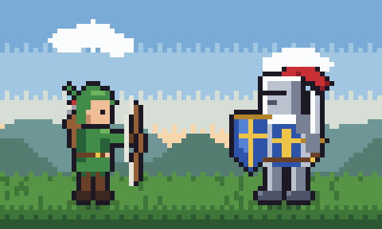
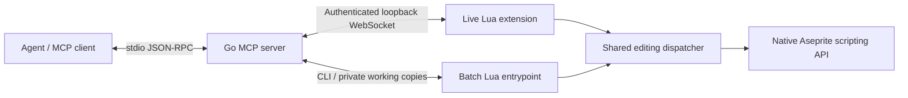

# Aseprite MCP

[](https://github.com/Jofdiazdi/aseprite-mcp/actions/workflows/mcp.yml)
[](https://pkg.go.dev/github.com/Jofdiazdi/aseprite-mcp)
[](LICENSE)

A local [Model Context Protocol](https://modelcontextprotocol.io/) server that lets AI agents create, inspect, edit, animate, preview, save, and export pixel art with [Aseprite](https://www.aseprite.org/).

The server is written in Go. A shared Lua dispatcher performs the actual artwork operations inside Aseprite, either in your open editor or through its batch CLI. The same tools work in both modes, and the Aseprite C++ application stays unchanged.

**Status:** early development, version 0.1.0. Real Aseprite batch tests cover RGBA, indexed, and grayscale artwork. Live bridge protocol tests are automated; pairing with a visible editor still needs manual verification. Aseprite is installed separately. This is an independent project, not an official Aseprite integration.

| Green slime — 32 × 32, 8 frames | Goblin — 48 × 48, 8 frames |
|---|---|
|  |  |
| [Editable sprite](artwork/green-slime/green-slime.aseprite) · [Contact sheet](artwork/green-slime/contact-sheet.png) | [Editable sprite](artwork/goblin/goblin.aseprite) · [Contact sheet](artwork/goblin/contact-sheet.png) |
| **Campfire in the woods — 64 × 48, 8 frames** | **Knight vs. bowman — 80 × 48, 12 frames** |
|  |  |
| [Editable sprite](artwork/campfire-woods/campfire-woods.aseprite) · [Contact sheet](artwork/campfire-woods/contact-sheet.png) | [Editable sprite](artwork/knight-vs-bowman/knight-vs-bowman.aseprite) · [Contact sheet](artwork/knight-vs-bowman/contact-sheet.png) |

These examples were drawn through MCP calls and native Aseprite operations. Each includes its drawing recipe, sprite sheet, animation, and verification record in [`artwork/`](artwork/).

## Contents

- [What it can do](#what-it-can-do)
- [Requirements](#requirements)
- [Build and install](#build-and-install)
- [Connect your agent](#connect-your-agent)
- [Create your first sprite](#create-your-first-sprite)
- [Run the animation example](#run-the-animation-example)
- [Tools](#tools)
- [How it works](#how-it-works)
- [Saving, revisions, and workspace boundaries](#saving-revisions-and-workspace-boundaries)
- [Troubleshooting](#troubleshooting)
- [Development and contributing](#development-and-contributing)
- [Scope and limitations](#scope-and-limitations)
- [Credits and licensing](#credits-and-licensing)

## What it can do

- Draw pixel patches, pencil strokes, lines, rectangles, ellipses, flood fills, and erasers.
- Draw compact character grids using a color legend, with separate symbols for skipping and erasing pixels.
- Create and organize image layers; change their visibility and opacity.
- Create, duplicate, reorder, and delete frames; set timing; move, flip, and copy cels; manage animation tags.
- Inspect metadata, raw pixels, visible composites, palettes, and animation differences.
- Return PNG previews directly to the agent, including cropped views, pixel grids, coordinate rulers, contact sheets, and onion skins.
- Save editable `.aseprite` documents and export PNG frames, animated GIFs, or PNG sprite sheets with JSON metadata.
- Apply edit collections atomically, reject stale revisions, and use native undo/redo in live mode.

## Requirements

| Requirement | Notes |
|---|---|
| Go 1.25 or newer | Required to build the server and run development commands. |
| Aseprite with scripting API 41 or newer | Required to perform artwork operations. API level is checked at runtime; this is not an Aseprite release number. |
| WebSocket support in Aseprite | Required only for live mode. |
| An MCP client with stdio support | Your client launches the server and exposes its tools to the agent. Image-content support is needed to display previews. |
| An existing artwork directory | Passed through `--workspace`; file operations stay within it. |

Linux, macOS, and Windows are targeted. CI runs Go protocol tests and builds on all three, with race detection and real headless Aseprite tests on Linux. That does not imply every GUI build or MCP client has been tested.

## Build and install

Clone this repository and build from its root:

```sh
git clone https://github.com/Jofdiazdi/aseprite-mcp.git
cd aseprite-mcp
go build -o dist/aseprite-mcp ./cmd/aseprite-mcp
go run ./cmd/package
```

On Windows, use this build command instead:

```powershell
go build -o dist/aseprite-mcp.exe ./cmd/aseprite-mcp
go run ./cmd/package
```

The outputs are the server executable and `dist/agent-mcp.aseprite-extension`. Aseprite itself is not bundled. You do not need to clone or compile its source to build this server.

For **live mode**, install the extension through **Edit > Preferences > Extensions > Add Extension** in Aseprite, select the archive, then restart the editor. Batch mode uses embedded Lua and does not require extension installation.

## Connect your agent

Choose the mode explicitly in your client configuration:

| | Live | Batch |
|---|---|---|
| Best for | Collaborating in an open editor | Unattended artwork and export workflows |
| Connection | Pair the extension with the running server | Server launches Aseprite subprocesses |
| Editing state | Open editor documents | Private temporary `.aseprite` working copies |
| Undo/redo | Native Aseprite history | Unsupported |
| Source files | Written by explicit `save_document` | Written by explicit `save_document` |

### Live mode

Create an artwork folder, then configure your MCP client to launch the built executable. Clients using the common `mcpServers` JSON format can use:

```json
{
  "mcpServers": {
    "aseprite": {
      "command": "/absolute/path/to/aseprite-mcp/dist/aseprite-mcp",
      "args": [
        "serve", "--mode", "live",
        "--workspace", "/absolute/path/to/artwork"
      ]
    }
  }
}
```

Use your actual absolute paths. On Windows, use the `.exe` name and escaped backslashes, such as `C:\\tools\\aseprite-mcp\\dist\\aseprite-mcp.exe`. Other clients may use a different configuration format; the command and argument list are the same.

1. Start or reload the MCP server through your client.
2. Find the pairing-file path in the server's stderr logs or the `get_status` result.
3. In Aseprite, choose **File > Scripts > Agent MCP: Connect / Status**.
4. Select that pairing JSON file and click **Connect**. Aseprite may prompt for its script file/network permissions.
5. Call `get_status` to confirm the connection, then `list_documents` to discover open artwork.

The same menu shows connection status and provides **Disconnect**. A server restart creates a new pairing file; pair again. Keep this file local because it contains the session token. Only one editor connection is accepted at a time.

### Batch mode

Use this configuration when the agent should operate without a visible editor:

```json
{
  "mcpServers": {
    "aseprite": {
      "command": "/absolute/path/to/aseprite-mcp/dist/aseprite-mcp",
      "args": [
        "serve", "--mode", "batch",
        "--workspace", "/absolute/path/to/artwork",
        "--aseprite", "/absolute/path/to/aseprite"
      ]
    }
  }
}
```

An explicit `--aseprite` path takes precedence; otherwise the server looks for `aseprite` on `PATH`. On macOS, this may be `/Applications/Aseprite.app/Contents/MacOS/aseprite`. Paths containing spaces remain single JSON arguments.

### Server options

```sh
aseprite-mcp serve --mode live|batch --workspace PATH [--aseprite PATH] [--timeout 30s]
```

| Option | Default | Meaning |
|---|---|---|
| `--mode` | `live` | Backend selection; there is no automatic fallback. |
| `--workspace` | Current directory | Existing directory for opening, saving, and exporting artwork. |
| `--aseprite` | `aseprite` on `PATH` | Native executable for batch mode. Live mode uses the connected editor. |
| `--timeout` | `30s` | Deadline per Aseprite operation. |

The executable is a stdio MCP server, so running it in a terminal waits for protocol messages rather than showing an interactive prompt. Diagnostics go to stderr; stdout is reserved for MCP.

## Create your first sprite

Ask your connected agent:

> Create a 32×32 green slime with a small palette and a clear silhouette. Use separate shadow and body layers, animate a bounce, show me a contact sheet and onion skin, then save slime.aseprite and export a GIF and sprite sheet in the workspace.

The tool workflow is **create → draw → inspect → refine → animate → inspect → save/export**. The server supplies agents with instructions for palette planning, silhouettes, drawing in passes, and animation timing.

For a minimal manual tool sequence:

1. Call `create_document` with `{"width":16,"height":16,"color_mode":"rgba"}`.
2. Read `document_id`, `revision`, and the first `layer_id` from its structured result.
3. Call `apply_edits`, replacing the placeholders below with those values:

```json
{
  "document_id": "RETURNED_DOCUMENT_ID",
  "revision": "LATEST_REVISION",
  "label": "Draw a small face",
  "edits": [{
    "op": "rows",
    "layer_id": "RETURNED_LAYER_ID",
    "frame": 1,
    "x": 4,
    "y": 4,
    "rows": [".AAAA.", "ABAABA", "AAAAAA", ".AAAA."],
    "legend": {
      "A": {"rgba": [90, 190, 110, 255]},
      "B": {"rgba": [20, 35, 30, 255]}
    }
  }]
}
```

Each ASCII character represents one pixel. `.` preserves the existing pixel, `~` erases it, and every other character needs a legend entry. Use equal-width rows. Coordinates start at zero, frames at one, and durations are milliseconds.

4. Call `render_preview` with the document ID, `frames: [1]`, and `scale: 8`. Add `grid: true` or `rulers: true` when useful.
5. Use the **new revision returned by the edit** for further mutations. Call `get_document` whenever you need the current state.
6. Call `save_document` with the document ID, latest revision, and `path: "face.aseprite"`.
7. Call `export_document` with those identifiers, `format: "png"`, and `path: "face.png"`.

Saving is explicit. Exporting does not save the editable source. Existing destinations require `overwrite: true`.

## Run the animation example

The included Go example is an MCP **client**: it launches the real server over stdio and calls its public tools. It creates a three-frame slime, renders a preview, saves the native document, and exports a GIF and sprite sheet.

From the repository root, choose a fresh output directory:

```sh
go run ./cmd/example --server ./dist/aseprite-mcp --aseprite /path/to/aseprite --workspace ./dist/my-first-slime
```

On Windows, use `--server ./dist/aseprite-mcp.exe`. Inspect `slime.aseprite`, `preview.png`, `slime.gif`, `slime.png`, and `slime.json` in the chosen directory. The checked-in [slime](artwork/green-slime/), [goblin](artwork/goblin/), [campfire](artwork/campfire-woods/), and [duel](artwork/knight-vs-bowman/) are larger examples; their creation records use repository-relative paths for portability.

## Tools

The server exposes 18 typed tools with structured results and actionable errors. Preview tools also return MCP PNG image content.

| Tools | Purpose |
|---|---|
| `get_status`, `list_documents`, `get_document` | Inspect connection, capabilities, document handles, revisions, layers, frames, palettes, and tags. |
| `open_document`, `create_document`, `close_document` | Manage artwork; closing unsaved work requires explicit discard. |
| `read_pixels`, `read_rows` | Inspect raw layer pixels or visible RGBA composites, including rectangular regions. |
| `apply_edits` | Apply an ordered collection of drawing, layer, palette, frame, cel, and tag operations atomically. |
| `render_preview`, `render_onion_skin`, `compare_frames` | Inspect artwork visually and measure changed pixels and their bounds. |
| `list_palette_presets`, `generate_color_ramp` | Discover attributed palettes and generate shading ramps without editing artwork. |
| `undo`, `redo` | Use native history in live mode. |
| `save_document`, `export_document` | Save `.aseprite`/`.ase`, or export PNG, GIF, and sprite-sheet JSON. |

See the [complete editing reference](docs/tool-reference.md) for operation fields, mode-specific colors, packed pixel values, preview limits, and export behavior. The client discovers input schemas through MCP `tools/list`.

## How it works



The Go server handles tool schemas, workspace paths, document sessions, file commits, PNG previews, comparison, and export orchestration. The Lua dispatcher validates defined edits and applies them through native APIs. Live requests execute on the editor's UI thread. Batch requests load and commit private working documents through Aseprite subprocesses.

`apply_edits` validates its collection and wraps it in a named transaction. Pixel edits use copied images and undoable commits; editing a linked cel detaches the target so other frames remain intact. Both backends share these editing semantics. See [`server.go`](server.go), [`service.go`](service.go), and [`assets/dispatcher.lua`](assets/dispatcher.lua) for the main boundaries.

## Saving, revisions, and workspace boundaries

- **Revisions are required for mutations.** Manual edits and earlier agent calls can invalidate a revision. Inspect the document and issue a fresh request when `stale_revision` is returned.
- **Source writes are explicit.** Unsaved batch work stays in private temporary files and is discarded on close or server shutdown. Live work stays in the editor until saved.
- **Overwrite is explicit.** Existing destinations require `overwrite: true`. Externally changed source files require reopening or saving elsewhere.
- **Files stay in the workspace.** Relative and absolute paths are checked, including resolved symlink targets. Choose a dedicated artwork directory.
- **Failures are reported.** Failed edit collections roll back. A lost live connection can leave a mutation's outcome uncertain; the server never automatically retries it. Reconnect and inspect first.
- **Exports and saves differ.** Export does not mark the document saved. Multi-file exports commit each output separately, so a filesystem failure can leave a partial sequence.

The live bridge listens on loopback and uses a random pairing token. The server accepts defined operations; arbitrary Lua, shell execution tools, remote hosting, and simultaneous agent clients are outside its scope. The workspace bounds server file operations; it is not an operating-system sandbox for Aseprite or other installed extensions.

## Troubleshooting

| Symptom | What to check |
|---|---|
| Executable not found | Use an absolute `--aseprite` path in batch mode. Check that your MCP client's environment can find the server executable. |
| Workspace error | Create the artwork directory first and pass its absolute path. Paths and symlinks must remain within it. |
| Live mode says disconnected | Start the server, install the matching extension archive, and select its current pairing file in Aseprite. |
| Incompatible API or bridge protocol | Use Aseprite API 41+ and rebuild/reinstall the extension from the same project revision as the server. |
| Aseprite lacks WebSocket support | Use a build with WebSockets for live mode, or select batch mode explicitly. |
| `stale_revision` | Call `get_document`, inspect the result, and use its latest revision. |
| Existing file or changed source error | Set overwrite explicitly only for the intended destination; reopen externally changed source files or save elsewhere. |
| Timeout or uncertain outcome | Reconnect and inspect before editing again. Increase `--timeout` for slow operations if appropriate. |
| No preview in the client | Check that the client displays MCP image content. The example also writes a local preview PNG. |
| Integration tests are skipped | Set `ASEPRITE_PATH` or install `aseprite` on `PATH`; do not use `-short` for native tests. |

When reporting a problem, include the platform, Aseprite API/version, server revision, backend mode, sanitized arguments, expected behavior, and actual error. Do not post pairing tokens or private artwork without permission.

## Development and contributing

See [CONTRIBUTING.md](CONTRIBUTING.md) for the development workflow, native integration tests, contribution expectations, and bug reports. Issues and focused pull requests are welcome at [GitHub](https://github.com/Jofdiazdi/aseprite-mcp).

```sh
go test ./...
go test -race ./...
go vet ./...
```

To include real artwork execution on Linux/macOS:

```sh
ASEPRITE_PATH=/absolute/path/to/aseprite go test -v ./...
```

On PowerShell, set `$env:ASEPRITE_PATH = 'C:\path\to\aseprite.exe'` before running `go test -v ./...`.

Native tests cover exact pixels in all three color modes, transparency, linked and offset cels, locked layers, rollback, undo/redo, stale/manual changes, file conflicts, animation timing, previews, and exports. Protocol tests exercise MCP schemas/results/errors/images and live authentication/disconnection. The [CI workflow](.github/workflows/mcp.yml) builds a pinned Aseprite checkout independently for Linux integration tests.

| Location | Responsibility |
|---|---|
| `cmd/aseprite-mcp/` | Stdio server entrypoint. |
| Root Go package | MCP tools, services, live/batch backends, previews, palettes, and file handling. |
| `assets/` | Canonical embedded Lua and attributed palette resources. |
| `extension/agent-mcp/` | Generated native extension sources. |
| `cmd/package/` | Extension source synchronization and archive packaging. |
| `cmd/example/` | Runnable MCP animation client. |
| `artwork/` | Editable examples, rendered outputs, and creation records. |
| `dist/` | Ignored local binaries, archives, and generated demos. |

After editing Lua or extension metadata, run `go generate ./...`, then rerun tests. Do not edit generated extension copies directly; a test detects drift from `assets/`.

## Scope and limitations

Only ordinary image layers are editable. Existing layer groups can be inspected; tilemap editing and frame moves involving tilemaps are rejected. Drawing is hard-edged without antialiasing. Batch mode has no undo/redo history. GIF exports use the full timeline and the format's centisecond timing resolution.

Arbitrary Lua execution, text rendering, tweening, advanced effects/selections, tileset editing, image-generation services, remote hosting, and simultaneous agent clients are deferred. A visible editor pairing session remains a manual verification task; automated native editing coverage currently uses the headless batch runtime.

## Credits and licensing

Built with the official [Go MCP SDK](https://github.com/modelcontextprotocol/go-sdk) and Aseprite's scripting API. The earlier [diivi/aseprite-mcp](https://github.com/diivi/aseprite-mcp) project informed the initial comparison and planning; no Python server code is included here.

Bundled palettes retain their original attribution: PICO-8 by Joseph White, DawnBringer 16/32 by Richard Fhager, and the Game Boy hardware palette. See [NOTICE.md](NOTICE.md) for source locations and third-party credits. Aseprite and dependencies retain their own licenses.

The server, bridge, documentation, and example artwork are licensed under [MIT](LICENSE). Third-party resources retain their own notices; see [NOTICE.md](NOTICE.md).
